<p align="center"></p>

# pyLBA

Linear Ballistic Accumulator models for simulating choices and response times,
Bayesian parameter estimation with PyMC, and prediction from fitted models.

## Installation

Requires Python 3.10 or newer.

```bash
pip install git+https://github.com/rgs2151/pyLBA.git
```

## Simulate

```python
from pyLBA import LBAModel, LBAParameters

model = LBAModel()
parameters = LBAParameters(A=1, b=[2, 3], v=2, s=1, tau=0.1)
data = model.generate_data(500, parameters, seed=42)
```

The result is a pandas DataFrame with `rt` and zero-based `response` columns.
Scalar parameters are shared across accumulators; vectors specify one value per
accumulator. Drifts follow normal distributions independently truncated above zero.

## Fit and predict

Estimate thresholds with the remaining parameters fixed:

```python
model.fit_mcmc(
    data,
    priors={"A": 1, "v": 2, "s": 1, "tau": 0.1},
    draws=1000,
    tune=1000,
    chains=4,
    random_seed=42,
)
predictions = model.predict(100, seed=7)

import arviz as az
print(az.summary(model.trace, var_names=["b"]))
```

Omit `priors` to use the default priors, or supply callables that create PyMC
variables. The default drift standard deviation is fixed at 1 to set the evidence
scale. `model.parameters` contains posterior means; `predict` simulates at those
means. EM fitting raises `NotImplementedError`.

## Documentation

[Documentation](https://rgs2151.github.io/pyLBA/) ·
[Quick start](https://rgs2151.github.io/pyLBA/quickstart.html) ·
[Examples](https://rgs2151.github.io/pyLBA/examples.html) ·
[Model guide](docs/guide.rst) ·
[Bayesian fitting](docs/fitting.rst) ·
[Contributing](CONTRIBUTING.md)

## Reference

Brown, S. D., & Heathcote, A. (2008). The simplest complete model of choice
response time: Linear ballistic accumulation. *Cognitive Psychology*, 57(3),
153–178.

[MIT license](LICENSE).
